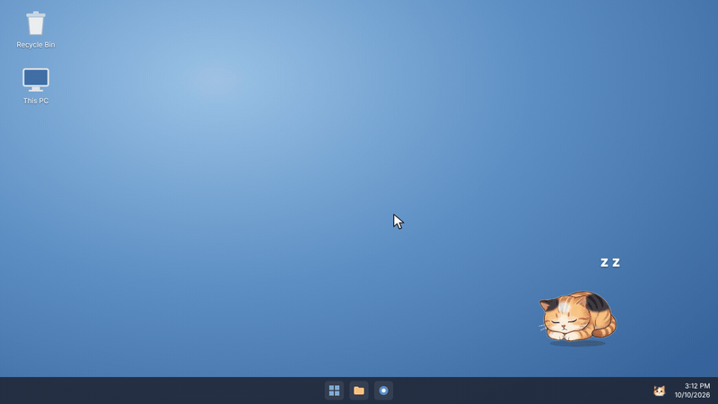

# DeskPet

**English** | [한국어](README.ko.md)

A little desktop pet for Windows that follows your cursor, naps when you stop, and tidies your Desktop. Files you save to the Desktop in one burst are grouped into a folder, and the pet asks what to name it.



Choose between **Calico** the cat and **Chapchu** the golden retriever, each in two art styles: illustrated or soft vector.

## Features

- **Follows your cursor** and dozes off after 8 seconds of stillness. Clicks on the transparent area around the pet pass straight through.
- **Tidies the Desktop by time, not file type.** Files saved within 20 minutes of each other go into the same folder.
- **Asks for a name** when a new batch starts. Type something like `Today's work`, or leave it blank for a dated folder such as `Sorted_10-04_1`. The bubble shows the exact name in advance.
- **Leaves things alone**: shortcuts, files still downloading, temp files, files that are open, and blank files created with *New* on the Desktop. Only the Desktop is watched.
- **Korean and English UI**, picked automatically from your Windows language.
- **Fully offline.** No network access, no telemetry (see [Privacy](#privacy)).

## Download

Grab `DeskPet.exe` from the [Releases](../../releases) page and double-click it. No installation needed.

Because the app is not code-signed, Windows may show a "Windows protected your PC" screen the first time. Click **More info → Run anyway**.

## Usage

Everything lives in the tray icon (the small cat face at the bottom-right of the taskbar; if you don't see it, click the **^** arrow).

| Tray menu | What it does |
| --- | --- |
| Hide / Bring back | Hide or show the pet. Tidying keeps working while hidden. |
| Character | Pick one of four: Calico or Chapchu, illustrated or soft style. |
| Follow cursor | Turn off to keep the pet in place. |
| Pause tidying | Stop organizing while you work directly on the Desktop. |
| New batch after | Idle time before the next file starts a new batch (10 / 20 / 30 / 60 min, default 20). |
| Open last folder | Open the folder the pet used most recently. |
| Language | Auto / 한국어 / English. |
| Start with Windows | Launch DeskPet when you sign in. |
| Quit | Exit the app. The pet's **X** button only hides it. |

You can also drag the pet anywhere. A full illustrated guide is in [`docs/`](docs).

> **Tip:** The built-in Windows screenshot tool (Win+Shift+S) saves to *Pictures\Screenshots*, not the Desktop. Point your capture tool at the Desktop if you want screenshots tidied too.

## How tidying works

1. A new file appears on the Desktop.
2. If the last file arrived less than 20 minutes ago, it goes into the same folder.
3. Otherwise the pet asks for a folder name:
   - **Type a name + Enter** → that folder (an existing folder with the same name is reused)
   - **Leave blank, press Esc, or wait 20 s** → a dated folder like `Sorted_10-04_1`
   - **Last folder** → continue the previous batch
4. If the pet is hidden, it skips the question, uses a dated folder, and shows a Windows notification.

## Privacy

DeskPet collects no personal data and never connects to the internet. Network access is blocked at several layers in the code: a Content Security Policy in the page, a session-level request filter, and Chromium's background services (spellcheck dictionary downloads, component updates, metrics) switched off at startup. The app requests no camera, microphone, or location permissions.

- **Reads:** names and sizes of new Desktop files (contents are never opened) and the cursor position (never stored).
- **Stores:** one settings file at `%APPDATA%\desk-pet\config.json` (character, menu settings, pet position, last folder path).
- **Never:** deletes or edits files, or touches anything outside the Desktop.

To remove every trace, quit DeskPet, delete `DeskPet.exe`, and delete the `%APPDATA%\desk-pet` folder.

## Build from source

Requires [Node.js](https://nodejs.org) (LTS) on Windows.

```
npm install
npm start          # run in development
npm run build      # creates dist\DeskPet.exe
```

## Project structure

```
main.js              main process: window, movement, tray menu, Desktop tidying, network lockdown
preload.js           safe bridge between the page and the main process
renderer/            the pet's page (HTML, CSS, character SVGs, UI strings)
assets/              app and tray icons
docs/                illustrated guides and demo videos
```

## License

[MIT](LICENSE)
